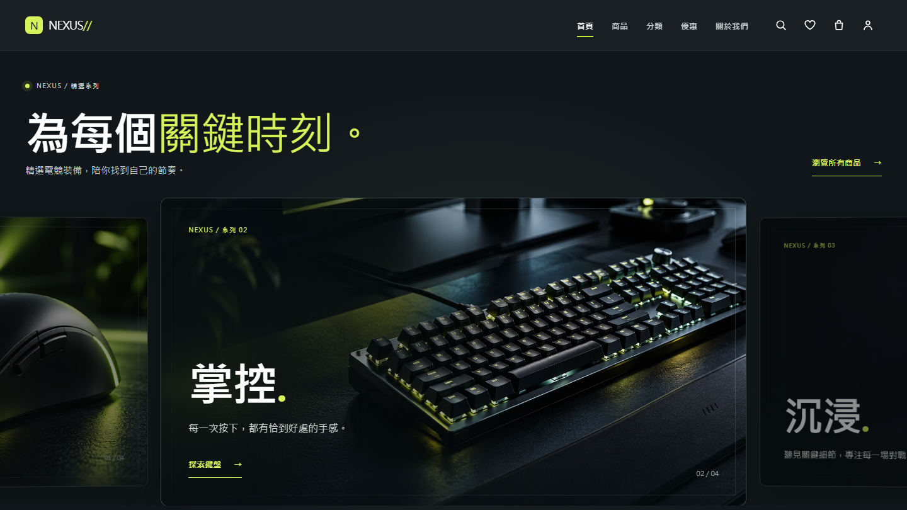

# NEXUS｜電競裝備展示網站

NEXUS 是以 Vue 3、Vite 與原生 CSS 製作的前端工程作品集。專案以 **Obsidian Editorial** 視覺呈現電競裝備，實作商品探索、響應式介面、互動輪播，以及保存在瀏覽器中的購物車與收藏。網站為展示用途，不提供真實購物服務。

**[瀏覽正式 Demo](https://nexus-gaming-ecommerce.vercel.app/)** · [查看商品列表](https://nexus-gaming-ecommerce.vercel.app/products) · [關於 NEXUS](https://nexus-gaming-ecommerce.vercel.app/about)

## 專案畫面



**其他畫面：** [手機首頁](docs/portfolio-screenshots/home-390.png) · [桌面商品列表](docs/portfolio-screenshots/products-1440.png) · [手機商品列表](docs/portfolio-screenshots/products-390.png) · [桌面關於頁](docs/portfolio-screenshots/about-1440.png) · [手機關於頁](docs/portfolio-screenshots/about-390.png)

截圖為本機 Production Preview 畫面；正式站可能因更新或輪播位置而略有差異。部分產品與品牌情境攝影為 AI 生成的概念圖片，不代表真實商品的精確外觀或規格。

## 核心功能

- **首頁敘事：**四系列 Editorial Coverflow、分類探索、主打商品故事、精選商品、品牌理念與結尾導購。Embla Carousel 提供拖曳、觸控、循環與吸附；GSAP 處理文字和媒體動態。輪播可手動切換或暫停 6 秒自動播放，並尊重 `prefers-reduced-motion`。
- **商品探索：**24 筆示範商品；可搜尋商品名稱、品牌與分類，依分類、價格及優惠條件篩選，並依價格或評分等方式排序。提供商品詳情與圖片瀏覽。
- **購物車與收藏：**加入、移除、調整數量及重整後保留狀態；資料儲存在瀏覽器 `localStorage`，不跨裝置同步。
- **展示頁面：**品牌 About 頁、會員介面及 Demo 結帳流程。結帳不會建立真實訂單或收取付款。

## 技術架構與 UI／UX

| 面向 | 實作 |
| --- | --- |
| 前端 | Vue 3、Vite、JavaScript、CSS |
| 路由 | Browser History API 手動處理路徑與查詢參數；商品列表優先載入，其餘頁面使用 Dynamic Import，並提供載入及失敗後備畫面。正式站以 Vercel rewrite 支援子路由直接開啟。 |
| 動態效果 | Embla Carousel Vue、Embla Autoplay 與 GSAP；路由離開時清理動畫與事件。 |
| 狀態儲存 | Vue composable 管理 Cart／Wishlist，使用 `localStorage` 保存。 |
| 圖片 | Hero 使用桌面與手機 WebP 素材；商品列表首張圖片使用 `loading="eager"` 與 `fetchpriority="high"`，其餘商品圖採延遲載入。媒體容器預留比例與載入失敗後備。 |
| 操作與適應性 | 桌面、平板、手機布局；鍵盤、觸控、可見焦點與 `prefers-reduced-motion` 支援。 |

目前路由實作**沒有使用 Vue Router**，也沒有 Pinia、後端 API 或資料庫；`vue-router` 雖列於 `package.json`，但未用於目前路由。

## 效能與檢查紀錄

正式站 `/products` 的 **Lighthouse Mobile 單次測試**紀錄由專案維護者提供：

| 指標 | 先前 | 更新後 |
| --- | ---: | ---: |
| Performance | 81 | **93（+12 分）** |
| Accessibility | — | 94 |
| Best Practices | — | 100 |
| SEO | — | 100 |

優化包含首屏商品圖載入優先度、Google Fonts 載入方式，以及路由層級的 JavaScript／CSS Code Splitting。分數會隨測試環境波動；Accessibility 分數不等於完整 WCAG 認證。2026-10-29 本機執行 `npm audit` 回報 **0 vulnerabilities**，僅代表當次依賴掃描結果。

## 本機執行

需使用符合 `package.json` `engines` 的 Node.js（`^22.18.0 || >=24.12.0`）。

```bash
npm ci
npm run dev
```

建立 Production Build 並在本機預覽：

```bash
npm run build
npm run preview
```

建置輸出位於 `dist/`。若部署至其他靜態主機，需將前端子路由回寫至 `index.html`。

## 展示範圍與後續方向

商品、價格、評價與優惠皆為示範資料。會員登入／註冊與結帳僅展示介面；沒有真實帳號、金流、訂單、配送或客服服務。請勿輸入真實個資。未來可評估後端服務、自動化測試與更完整的無障礙稽核；這些尚未納入目前版本。
