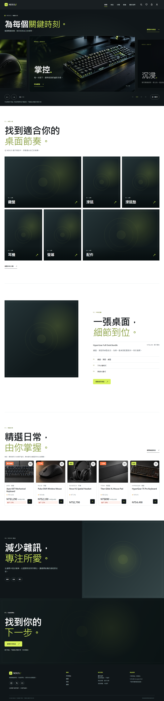
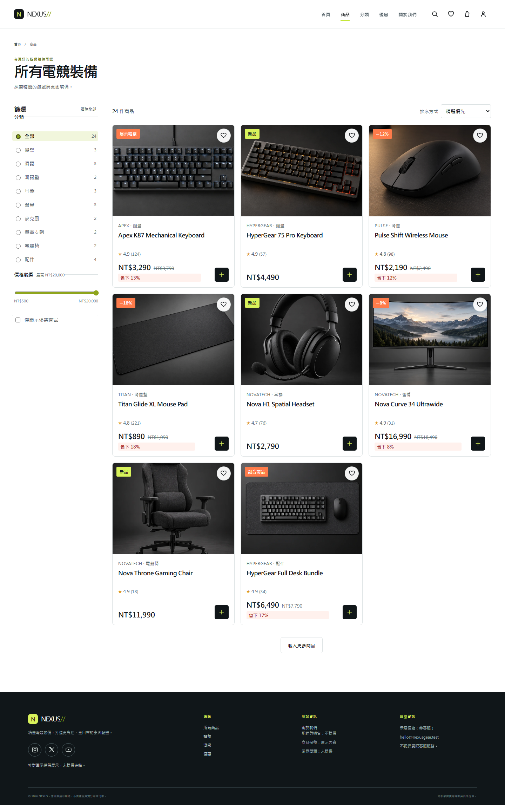
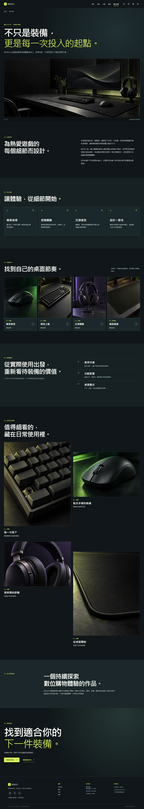
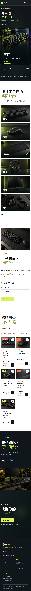

# NEXUS — 電競裝備展示網站

NEXUS 是 Vue 3 與 Vite 製作的前端電商作品集。網站以 Obsidian Editorial 視覺呈現電競周邊與桌面配置，包含四系列 Coverflow、商品探索、關於品牌的展示頁，以及可操作的購物車與收藏清單。

> **展示範圍：**商品、價格、評價與優惠為示範資料。登入、註冊、會員與結帳皆為介面展示；沒有後端帳號、真實訂單、付款、配送或客服服務。請勿輸入真實個資。

## 功能

- **首頁：**六個敘事區塊、四系列 Full-Bleed Coverflow、6 秒自動輪播、手動播放／暫停、拖曳、鍵盤操作與 reduced-motion 支援。
- **商品：**24 筆示範商品、關鍵字搜尋、分類、價格與優惠篩選、排序、商品詳情與圖片瀏覽。
- **購物車與收藏：**加入、移除、調整數量；使用瀏覽器 `localStorage` 保存，沒有跨裝置同步。
- **關於我們：**八個品牌展示區塊及四系列入口。
- **響應式介面：**桌面、平板與手機版導覽、商品網格及篩選抽屜。

## 畫面

| 首頁 | 商品列表 |
| --- | --- |
|  |  |

| 關於我們 | 手機首頁 |
| --- | --- |
|  |  |

以上截圖由本機 production preview 產出，非雲端服務畫面。Hero 與 About 的 AI 圖片為作品集示意攝影，不代表特定真實商品的精確外觀或規格。

## 技術

- Vue 3、Vite、JavaScript、CSS。
- Embla Carousel 與 GSAP 用於首頁輪播和局部動態效果。
- Browser History API 處理前端路由；`localStorage` 保存購物車與收藏。
- 本專案目前不使用 `vue-router` 的路由實作，雖然它仍列於依賴中。

## 本機執行

需符合 `package.json` 的 Node.js `engines` 範圍。

```bash
npm ci
npm run dev
```

正式建置與本機預覽：

```bash
npm run build
npm run preview
```

建置輸出在 `dist/`。靜態主機需將未知路徑回寫到 `index.html`，否則直接開啟或重新整理商品與 About 子頁面可能得到 404。公開部署前，應依實際網域設定分享預覽與 canonical URL，並重新驗證所有子路由。

## 品質與限制

專案支援鍵盤操作、可見焦點與 `prefers-reduced-motion`。Phase 3 的實際檢查結果、未完成項目與發布判定記錄於 [品質報告](docs/phase3-production-readiness.md)。本機測試不能代表真實使用者的 INP 或雲端正式環境品質。

目前沒有經本階段確認的公開 Demo 網址，因此不列出 Live Demo 連結。未來可補上正式部署、路由專用社群預覽、正式自動化測試與持續整合。
